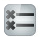
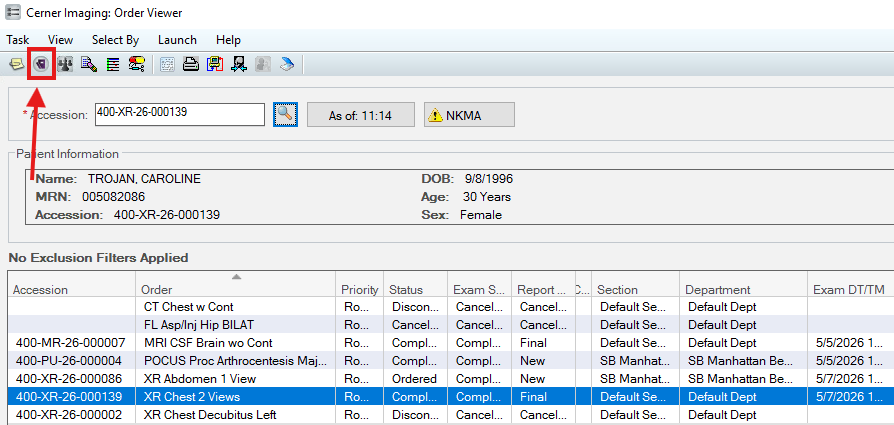
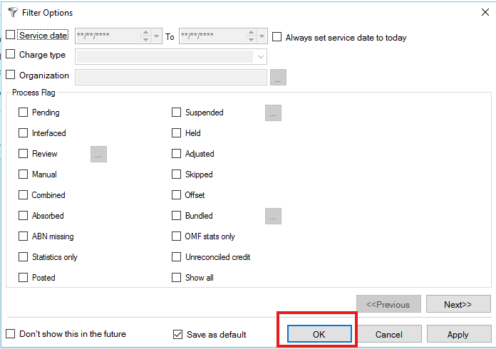
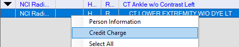
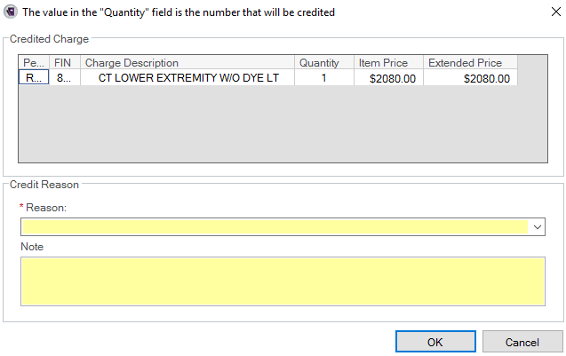
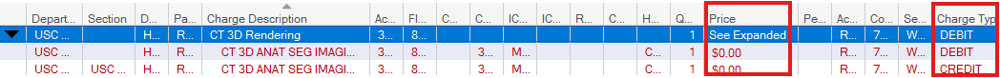

  

# 3D Orders Guide

## Table of Contents
- [3D Orders Guide](#3d-orders-guide)
  - [Table of Contents](#table-of-contents)
- [What date do I use when I complete my 3D order in Cerner?](#what-date-do-i-use-when-i-complete-my-3d-order-in-cerner)
- [When do I need a new FIN?](#when-do-i-need-a-new-fin)
- [How to Credit an Order?](#how-to-credit-an-order)

# What date do I use when I complete my 3D order in Cerner?
- If the 3D order was ordered with original diagnostic order, you can complete your 3D order with the **same** date as the **original diagnostic order**.
- If the 3D order was placed after the diagnostic order, you should complete the 3D order with the date that you completed your 3D imaging. 
  - **Example:** A CT Ankle w/o was ordered on 11/01. A 3D order was placed after the fact, and you completed your 3D images on 11/02. You should complete your order with a date of 11/02
- If there is no original diagnostic order, you should complete the 3D order with the same date that it was entered.

# When do I need a new FIN?
The FIN associated with the 3D order should also be associated with the correct location and date of service for the 3D order.
- If a 3D order is placed outside of Keck Hospital or HC2 (any order that does not have 520 or 267 accession number) it will need a new FIN.
- If an out patient has a 3D order placed after the diagnostic order, a new FIN must be created.

# How to Credit an Order?

- Open Order Viewer from the Cerner app bar: 
- Search for the exam that you want to remove the charge for
- Make sure the desired exam is highlighted and then click on the Charge Viewer Icon
  
- If the "Filter Options" menu pops up, click "OK"
  
- Click on the drop down to view the charges associated to the desired study
- Right-click on the charge that you want to credit and click "Credit charge"
  
- Enter your reason for crediting the charge using the drop down field, "Reason"   
  
- Click "OK"
- You should now see the charge turn red ot indicate the charge has been credited
  